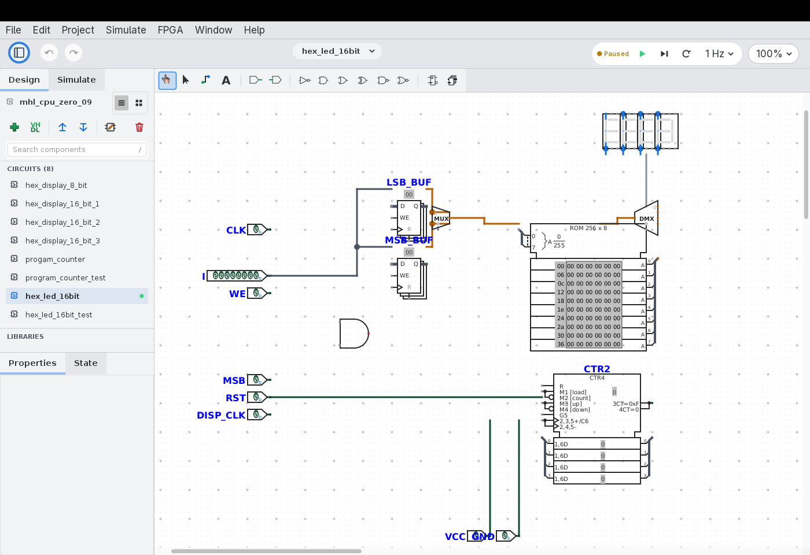
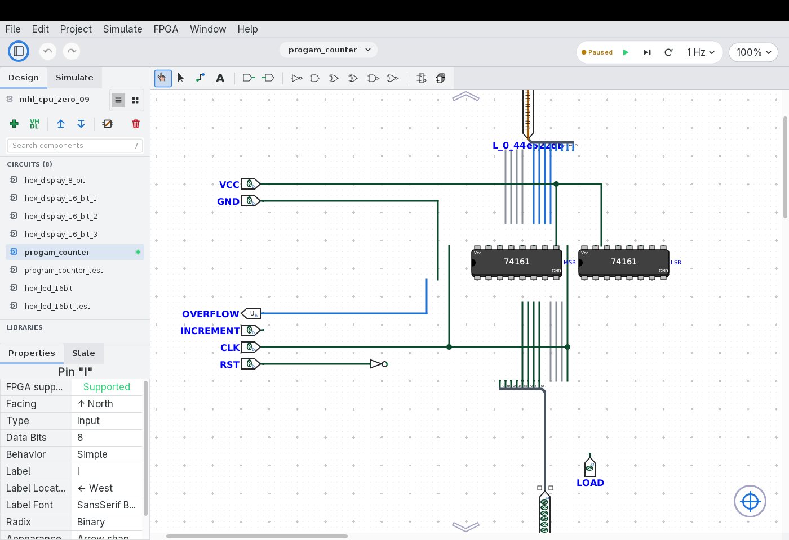
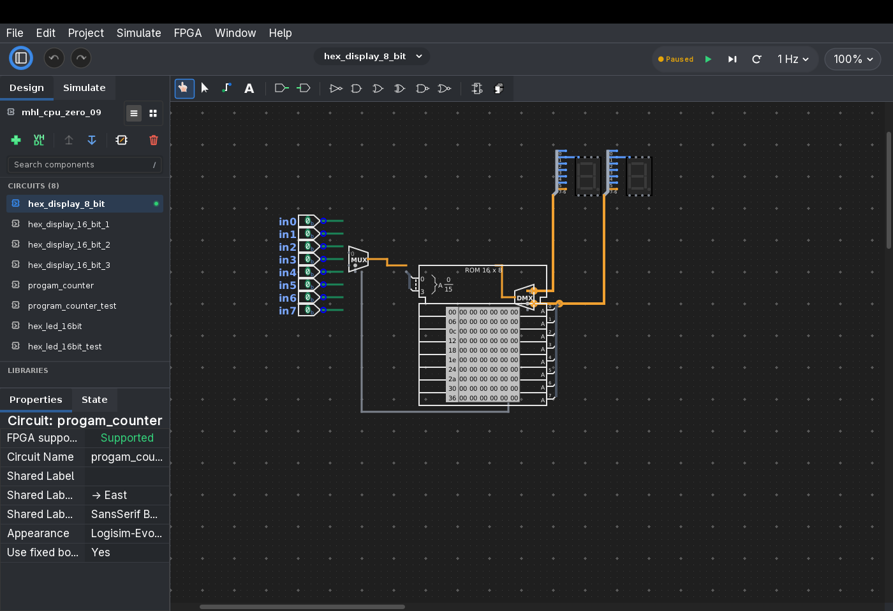

---

# Additional information #

* [« Go back](../README.md)
* **Screenshots**
  * [KDE](#kubuntu)

## Gallery ##

High-resolution screenshots demonstrating Logisim-evolution+ in action across Light and Dark appearances:

### Modern Light Appearance ###

### Component Properties & Layout ###

### Modern Dark Appearance ###

